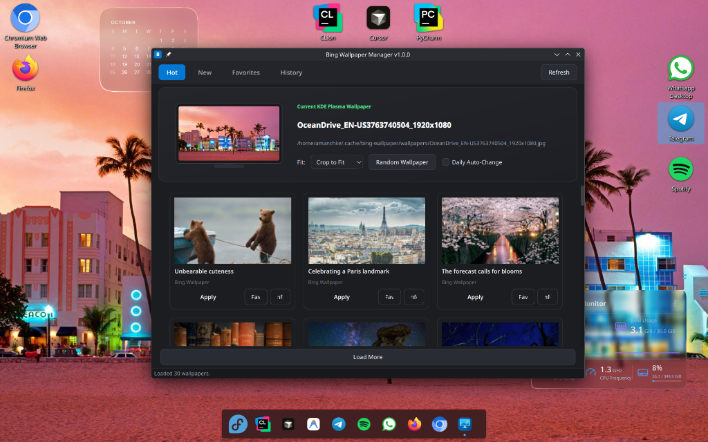

<div align="center">

# Bing Wallpaper Manager for KDE Plasma

**A modern, native desktop Bing wallpaper manager for Fedora Linux & KDE Plasma 5/6, inspired by Windows 11 Personalization.**

[](https://www.python.org/)
[](https://pypi.org/project/PySide6/)
[](https://fedoraproject.org/)
[](LICENSE)

<br/>



</div>

---

## Overview

**Bing Wallpaper Manager** brings the clean, streamlined personalization experience of Windows 11 and Windows Spotlight directly to **Fedora Linux (KDE Plasma 5 & 6)**.

It automatically fetches daily and trending high-resolution wallpapers from [bing.gifposter.com](https://bing.gifposter.com/), presents them in an interactive card gallery with background stories, and applies your selected image to your desktop with a single click using KDE Plasma's native tools.

---

## Features

- **Windows 11-Inspired UI**:
  - **Hero Monitor Preview**: Displays an interactive mini-monitor rendering your currently active desktop wallpaper in real-time.
  - **Fill Mode Selector**: Choose between *Crop to Fit*, *Fit to Screen*, or *Stretch* on the fly.
  - **One-Click Random**: Instantly switch to a random trending wallpaper.
- **Curated Wallpaper Categories**:
  - **Hot**: Most popular and trending daily Bing wallpapers.
  - **New**: Chronological daily archive updated every 24 hours.
  - **Favorites**: Locally saved collection of your favorite wallpapers.
  - **History**: Quick access to all wallpapers you have previously applied.
- **Rich Spotlight Inspector**:
  - View full-resolution photo details, geographical location, date, and dimension metadata.
  - Read the daily story and educational context behind each photograph directly from Bing.
  - Download originals directly to `~/Pictures/BingWallpapers/`.
  - Open the source page in your default browser.
- **KDE Plasma Native Integration**:
  - Seamlessly changes desktop wallpapers using `plasma-apply-wallpaperimage` (with automated D-Bus fallback).
  - Automatically queries active wallpaper from KDE's `plasma-org.kde.plasma.desktop-appletsrc`.
- **System Tray & Automation**:
  - Runs unobtrusively in the KDE system tray.
  - Built-in background timer for automatic daily wallpaper rotation.
  - CLI switch mode (`--next`, `--tray`) for custom scripts, hotkeys, or cron jobs.
- **Polished Performance**:
  - Asynchronous background image caching using `QThreadPool` for silky smooth scrolling without UI freezes.
  - Clean, dark Fluent / Breeze aesthetic with zero distracting emojis.

---

## Requirements

The application runs out-of-the-box on standard Fedora installations with KDE Plasma:

- **OS**: Fedora 39, 40, 41+ (or any Linux distribution running KDE Plasma 5.24+ / Plasma 6)
- **Desktop Environment**: KDE Plasma (`plasma-apply-wallpaperimage` from `plasma-workspace`)
- **Python**: 3.11+
- **Python Libraries**:
  - `PySide6`
  - `requests`
  - `beautifulsoup4`

To install system dependencies on Fedora:
```bash
sudo dnf install -y python3-pyside6 python3-requests python3-beautifulsoup4 plasma-workspace
```

---

## Installation & Setup

1. **Clone the repository**:
   ```bash
   git clone https://github.com/your-username/bing-wallpaper-kde.git
   cd bing-wallpaper-kde
   ```

2. **Run the installation script**:
   ```bash
   ./install.sh
   ```
   This registers the desktop launcher and high-resolution icon into `~/.local/share/applications` and `~/.local/share/icons`.

3. **Launch the application**:
   - Open your KDE application launcher (Kickoff) and search for **Bing Wallpaper Manager**.
   - Or press `Alt + Space` (KRunner) and type `Bing Wallpaper`.

---

## Command Line Usage

You can also run the app directly from your terminal:

```bash
# Open the full GUI window
python3 main.py

# Start minimized to the system tray in background
python3 main.py --tray

# Switch to the next trending wallpaper immediately (headless, no GUI)
python3 main.py --next --category hot

# Switch to the newest wallpaper immediately
python3 main.py --next --category new
```

> **Tip:** You can bind `python3 /path/to/main.py --next` to a KDE global keyboard shortcut (e.g. `Meta + W`) for instant wallpaper changes!

---

## Project Structure

```
bing-wallpaper-kde/
├── assets/
│   └── screenshot.png        # Application screenshot for documentation
├── bing_wallpaper/
│   ├── __init__.py
│   ├── config.py             # Storage paths, endpoints, and default config
│   ├── models.py             # WallpaperItem dataclass
│   ├── scraper.py            # bing.gifposter.com parser (Hot, New, stories)
│   ├── wallpaper_manager.py  # KDE Plasma wallpaper engine (plasma-apply-wallpaperimage)
│   ├── storage.py            # SQLite database (Favorites, History) & JSON settings
│   ├── downloader.py         # Threaded image caching and file manager
│   └── ui/
│       ├── __init__.py
│       ├── styles.py         # Fluent / Breeze QSS stylesheet
│       ├── monitor_preview.py# Hero monitor widget previewing current wallpaper
│       ├── wallpaper_card.py # Interactive wallpaper grid card
│       ├── detail_dialog.py  # Spotlight-style information modal
│       ├── tray_icon.py      # System tray icon and context menu
│       └── main_window.py    # Main window assembling all components
├── resources/
│   └── icon.png              # Vector-styled high-res application icon
├── com.github.bing_wallpaper_kde.desktop # XDG Desktop specification file
├── install.sh                # One-click desktop integration script
├── main.py                   # Main executable entry point
└── README.md
```

---

## Data & Caching Paths

- **Thumbnails Cache**: `~/.cache/bing-wallpaper/thumbs/`
- **Full Wallpapers Cache**: `~/.cache/bing-wallpaper/wallpapers/`
- **Saved Wallpapers**: `~/Pictures/BingWallpapers/`
- **Database (Favorites & History)**: `~/.local/share/bing-wallpaper/wallpapers.db`
- **Settings**: `~/.config/bing-wallpaper/settings.json`

---

## Contributing

Contributions, bug reports, and feature suggestions are welcome! Feel free to open an issue or submit a pull request.

---

## License

This project is licensed under the [MIT License](LICENSE).
Wallpapers and related media are copyrighted by Microsoft Bing and their respective photographers.
